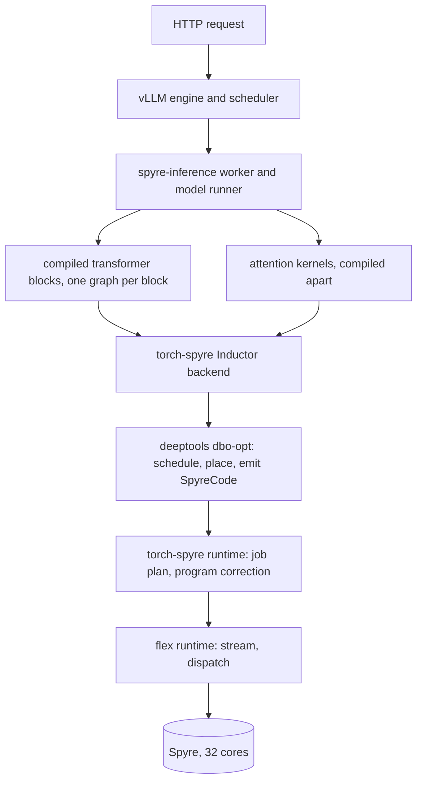
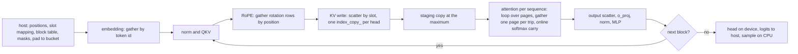
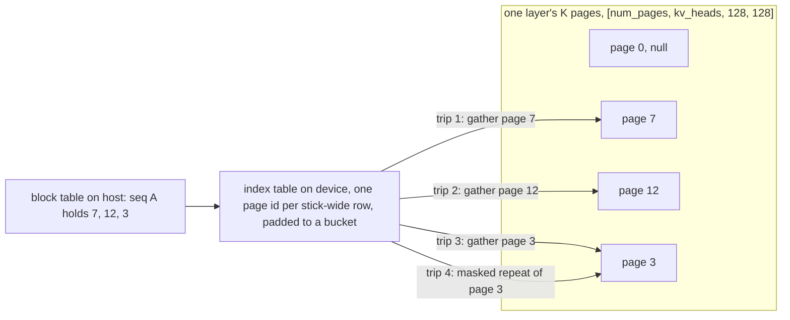

# How a decoder is served on Spyre: vLLM to the plugin to torch-spyre to deeptools

The life of a Granite request, from the HTTP call to the token, with the compile, the warm-up and the page cache explained on the way. Written for someone who knows transformers and PyTorch and has not read the plugin.

- As of: spyre-inference `58631f24`, torch-spyre main `4a0c180d`, the Spyre Knowledgebase replica, 26 October 2026
- Sources: the Knowledgebase stack and interface pages, the plugin read at its head, our own decoder path read of 26 October

## The one idea to hold on to

A Spyre binary is compiled for exact shapes. Every tensor extent, every address and every loop count is baked in when the program is built. Nothing about this is like a GPU, where one kernel takes any shape at launch.

So the whole serving stack is organised around one question: how do we make every shape known before the first request arrives? The answers are buckets, padding, fixed-size pages and a warm-up that compiles everything up front. Once you see that, every odd-looking piece of the plugin makes sense. The symbolic shapes work is about loosening exactly this constraint, in one controlled place, and the last section says where.

## The cast

| Layer | What it is | One line on its job |
|---|---|---|
| vLLM | the serving engine | takes requests, schedules them into batches, owns the KV cache bookkeeping, samples tokens |
| spyre-inference | vLLM's platform plugin for Spyre | tells vLLM how to run on this device: the worker, the model runner, the attention backend, the shape buckets, the warm-up |
| torch-spyre | the PyTorch backend | registers the `spyre` device and an Inductor backend that turns a compiled graph into Spyre programs |
| deeptools | the backend compiler | turns torch-spyre's output into the device binary, schedules it over the cores, prepares the host-side corrections |
| torch-runtime and flex | the runtimes | torch-spyre's C++ side builds a job plan per launch, flex drives the device: streams, allocation, dispatch |

And the chip, in the few facts that matter here. Thirty-two cores. Each core has 2 MB of on-chip scratchpad, the LX, between the shared cache and the compute; off-chip memory is LPDDR. Memory is organised in sticks: 128 bytes, which is 64 elements at 16 bits. The device float is DL16, a 16-bit format that is not IEEE half, and every model runs in it. Integer work is weak: the plugin converts every integer input to 64-bit at the model boundary because the scheduler cannot place a 32-bit integer add.

## Words you will meet

| Word | Meaning here |
|---|---|
| bucket | one of a fixed ladder of shapes the plugin compiles for. A request is padded up to the nearest one |
| variant | one compiled attention program, identified by its shape tuple, for example (number of pages, query length) |
| page, block | a fixed slab of the KV cache holding `block_size` tokens of one layer's keys or values, 128 tokens by default |
| slot | the row inside the whole cache where one token's key goes: `block_number * block_size + offset` |
| staging buffer | a device buffer allocated once at the maximum, into which a variable number of rows is copied so that the kernel always sees the same shape |
| SDSC | torch-spyre's description of one device op: what to compute, over what shape, with what layout |
| bundle | the file that sequences the SDSCs of one compiled graph and carries its loops |
| SpyreCode | deeptools' output: the device program plus the list of host steps needed to launch it |
| job plan | the launch recipe torch-spyre builds from SpyreCode: host compute, transfers, compute |
| program correction | the host step before a launch that fills runtime values into the program, addresses today, our loop count tomorrow |
| trip count | how many times a device loop runs. The one number the symbolic shapes design lets vary per call |

## 1. Loading Granite

vLLM discovers the plugin through two entry points, one that registers the platform and one that registers the custom ops. The platform tells vLLM to treat the device as a CPU-like out-of-tree device with a Spyre dispatch key. From there vLLM's ordinary objects are used, subclassed where Spyre needs something different: a worker, a model runner, a scheduler that caps how many prefills share a batch, and an attention backend. The default backend keeps the cache head-major, which is one of two layouts the plugin supports.

Granite has no model class of its own in the plugin. It runs vLLM's in-tree definition with Spyre's ops swapped in underneath: the linear, the embedding, the rotary embedding, the attention. Loading goes like this.

1. The weights are loaded on the CPU. Every model is forced to float16, which becomes DL16 on the device.
2. The plugin checks and fixes the shapes the device wants: the head dimension padded to a multiple of 128 where needed, which Granite at head size 128 does not need, and the MLP width padded to a multiple of 64. Linear weights are stored transposed, so a projection is a plain matmul against a `[in, out]` matrix.
3. The model moves to the device. The rotary embedding builds its rotation table on the CPU and primes it on the device before any compile, so the per-step work is only a gather by position. The vocabulary table goes over rows-outermost, so the embedding is a gather by token id.
4. The KV cache is allocated: one dense tensor for keys and one for values per layer, sized once and never resized. The count of pages is `max_num_seqs * ceil(max_model_len / block_size) + 1`, the extra one being a null page that padding rows write into harmlessly. Head-major, each tensor is `[num_pages, num_kv_heads, block_size, head_size]`, laid out so that a (page, head) pair is one row at the device's outermost position, because that is the position a gather can address cheaply.
5. The attention staging buffers are allocated once at `max_num_batched_tokens + 1` rows.

At this point the device holds the weights, the rotation table, the vocabulary, zeroed pages and empty staging buffers. Nothing has been compiled.

## 2. Compiling

Then `_compile_for_spyre` runs. Its default granularity is the transformer block: every block in the repeated block list gets `block.compile(backend="inductor", fullgraph=True, dynamic=False)`, in place. One graph per block, and identical blocks share one code object, so Granite's forty layers are one block class and compile once per shape. The pieces outside the blocks, the embedding, the final norm and the head, compile themselves lazily as their own small graphs on first call. The attention kernels are compiled separately at module scope, also `dynamic=False`, because they contain a loop over pages that the model graph cannot hold.

`dynamic=False` is the whole plugin's stance: 32 compile sites, and two comments say why, the backend rejects a symbolic shape. Every new shape is a new graph. That is what the buckets and the warm-up are for.

What happens to one graph inside torch-spyre. Inductor hands torch-spyre the lowered graph. torch-spyre's decompositions and lowerings turn each op into something the device has, then its own pass pipelines run: layout propagation chooses which axis of each tensor sits on the stick, restickify inserts the copies that change that, work division splits each op across the 32 cores, and scratchpad planning decides what lives in the 2 MB per core and what streams through off-chip memory. The result is one SDSC file per op and one `bundle.mlir` that sequences them and carries any loops. That bundle and those SDSCs go to deeptools.

deeptools, through `dbo-opt`, reads the bundle, schedules each program as a tree of dataflow operations, lowers it through its intermediate forms to the device's instruction stream, lays out the memory, prepares the runtime corrections, places the program and emits SpyreCode: the binary plus the host steps a launch needs. The output is a directory per kernel, cached under the Inductor cache root. A second process with the same graph and the same cache root reuses it, which is why a cold compile and a warm start are such different numbers.

## 3. Warm-up, or compiling everything before the first request

The worker's `compile_or_warm_up_model` calls the runner's `warming_up_model`, then arms the compile guard. What gets compiled is decided by ladders.

The body ladder, `compile_sizes`, is a list of token counts: the powers of two below `max_num_seqs`, then `max_num_seqs` itself, then `min(max_num_batched_tokens, 512)`. With the registry's single-device Granite configuration, `max_num_seqs` 32 and 512 batched tokens, that is 1, 2, 4, 8, 16, 32 and 512. The runner does one dummy forward at each, largest first, which compiles the block graph seven times, plus the embedding at each width, plus the head at each logits row width. Every decode step will land on one of the small buckets, every prefill chunk on 512, because prefill is always chunked at 512 tokens.

The attention ladders are separate because attention never sees the token bucket. Its shapes are the number of pages a sequence has and the query length. Pages come in powers of two from `block_size` up to `max_model_len`: at block 128 and a 4096 context that is 1, 2, 4, 8, 16 and 32 pages. Query lengths are 1 for decode and multiples of 512 for prefill. For batched decode there is a grid of sequence-count buckets, powers of two up to 32, against page buckets, with a chunking rule that keeps `num_seqs * blocks_per_chunk` at 32 entries per trip. After the dummy runs, `_record_attention_graphs` traces every per-sequence variant and the full batched grid for each distinct layer shape. For this configuration that is 12 per-sequence variants and 36 batched ones, 48 attention programs, on top of the 7 body programs and the small ones outside the blocks. Granite's layers share one shape, so the 48 are recorded once and reused by all forty layers.

The log says what it did: "Warmup complete in %.3fs for %d buckets", "Recording %d per-seq + %d batched-decode attention variants for layer", "Attention graph recording complete: %d graphs in %.3fs". Nothing in the repository reads those three lines back as a measurement, which is why the decoder plan's first step is to measure them.

Then the guard is armed. It has registered every block and every kernel; after warm-up any compile of one of them is reported, as a warning by default or as an error. The reason is cost: a miss during serving is a full Inductor compile on the request path, and because the plugin raises Dynamo's recompile limits to 100000, a miss never falls back to eager either. It recompiles, every time the shape is new. A deployment therefore never wants a shape the warm-up did not see.

## 4. One prefill step, through a block

Take a prompt of 100 tokens. vLLM's scheduler puts it in a batch and the plugin's runner prepares the step on the host: the positions 0 to 99, the block table, the sequence lengths, and the slot mapping, computed in plain PyTorch, one slot per token. The step is padded up the body ladder: 100 tokens becomes 512 rows, the extra rows pointing at the null page. The integer inputs are converted to Spyre int64 and the float ones copied over asynchronously.

The embedding is the first gather on the device: the vocabulary table indexed by token id, `F.embedding` on a padded row count.

Then each block graph runs, forty times. Inside one graph, in order:

1. The input norm, fused with the previous residual add.
2. The fused QKV projection, a matmul against the transposed weight.
3. RoPE: the second gather, `index_select` on the rotation table by position, then the 2 by 2 rotation on the query and the key.
4. The KV write: the first scatter. Head-major, it is one `index_copy_` per KV head on the keys and one on the values, each with a `[T]` int64 row index derived from the slot mapping, `(page * num_kv_heads + head) * block_size + offset`. This is traced inside the block graph, so Inductor fuses it with the norm, the projection and RoPE. It is always compiled, because the eager op refuses an int32 index.
5. The staging copy: `q_in[:rows] = query`, a store of the real rows into the buffer allocated at the maximum, so that what follows always sees the same shape.
6. The attention op, `torch.ops.vllm.unified_attention_with_output`, opaque to the graph. It dispatches into the attention backend, described next.
7. The copy back from the staging output, the output projection, the post norm, the MLP.

The attention backend runs a Python loop over the sequences in the batch, and for each one calls the compiled per-sequence prefill kernel. That kernel is where paging shows. It walks the sequence's pages one per trip of a `for_each_tile` loop. Each trip gathers one page out of the cache, the third gather, with a one-element int32 index, `k_pages.index_select(0, page_index[0, 0:1])`, computes `q @ k.T * scale` against that page, adds that page's mask tile, and updates a three-value carry: the running maximum, the running sum of exponentials and the running output, with a rescale of `exp(-relu(scores_max - tile_max))` when the maximum moves. This is the online softmax, the same recurrence as flash attention. At the end the kernel writes its rows into the output buffer with `index_copy_`, the second scatter. The query rows it needs were gathered in-graph too, `query.index_select(0, query_row_index)`.

Why a loop over pages rather than one matmul over all the keys: because the number of keys is not a shape the kernel may depend on. The page count is padded to its bucket by repeating the last real page with a mask that zeroes it, so a 100-token prompt at block 128 is one real page, padded to the one-page bucket, and a 1100-token context would be nine real pages padded to the 16-page bucket, seven of them masked repeats.

After the last block, the final norm runs eagerly, the head runs as a matmul on the device at a logits row bucket, the logits come back to the host, and sampling runs on the CPU with the plugin's own kernels.

## 5. One decode step

Decode is the same picture with one token per sequence. The rows of the step are the sequences, padded on the same body ladder, so a batch of 5 runs as 8. The block graph is the small-bucket variant. The KV write scatters one key and one value per sequence into the next slot.

Attention goes to the batched decode kernel first, when its preconditions hold: the batched path is on, the layout is head-major, no ALiBi, and the padded sequence count times the pages per chunk is below the page count. That kernel tiles over `(num_seqs, blocks_per_chunk)` at a time and gathers its pages with a two-dimensional index, so it reads `num_seqs * blocks_per_chunk` pages per trip. Sequences the batched kernel cannot take fall to the per-sequence loop, each on its own (pages, query length 1) variant. Query length 1 attention is bandwidth: the step's cost is the number of pages read, which is the padded page count, not the real one. That is the padding a declared page axis would remove.

## 6. KV paging, in one place

Paged attention is vLLM's way of not pre-allocating a maximum-length cache per sequence. The cache is a pool of fixed-size pages; a sequence holds a list of page numbers, its block table, and grows by taking another page. Memory is used by what is actually there, and sequences of different lengths share the pool.

On a GPU the attention kernel then reads the pages it needs through the block table at runtime. On Spyre that cannot be the end of it, for three reasons that all come back to the one idea.

- The cache must be a fixed tensor. The pages of one layer are one dense tensor sized at init, because every program that touches it was compiled against that shape.
- A page is read by a gather with a one-element index, one page per trip, because a slice of "the first N pages" would be a symbolic shape. Each index sits in its own stick-wide row, so the block table itself cannot be the index and is turned into a per-sequence index table on the host. And the indexed dimension has to be the tensor's outermost on the device, or the gather copies the whole tensor, which is why the page is the first dimension of the layout.
- The number of pages a kernel reads is a compiled variant. So page counts are bucketed in powers of two, and a sequence pays for the bucket.

The page size is 128 tokens by default and must be a multiple of 64, one stick of 16-bit elements per row. A context of N tokens holds `ceil(N / 128)` real pages and reads the next power of two: 1100 tokens is 9 pages real, 16 pages read. The null page, page 0, is where padded rows write so that no real page is disturbed.

## 7. Every gather and scatter, in one table

| Where | Op | Index | What it does |
|---|---|---|---|
| embedding | `F.embedding` | token ids, `[T]` | rows of the vocabulary table |
| RoPE | `index_select` | positions, `[T]` | rows of the rotation table |
| KV write | `index_copy_`, one per KV head | row index from the slot mapping, `[T]` | writes this step's keys and values into their pages |
| attention, query rows | `index_select` | query row index | the sequence's rows out of the staging buffer |
| attention, page read | `index_select` with a one-element index, or a 2-D `aten.index` in batched decode | page id per trip | one page of keys or values per trip |
| attention, output | `index_copy_` | query row index | the sequence's rows back into the staging output |
| staging | slice store `q_in[:rows] = query` | a slice bound | the real rows into the maximum-sized buffer |
| logits | host indexing | the last token of each sequence | which rows go to the head |

The reads are gathers and the writes are scatters, and every one of them carries a shape that today is a bucket: the token count, the page count or the query length.

## 8. What happens at a launch

The compiled kernel's SpyreCode lists host steps. torch-spyre's C++ side turns them into a job plan: host compute, host-to-device transfers, the compute itself, device-to-host transfers. The step that matters for the symbolic shapes work is the first one, program correction. The device program contains places that depend on values known only at launch, the buffer addresses above all. Before each launch the host computes those values, writes them into small correction tensors, and the device applies them by a hardware scatter into the program's own instruction words, 128-byte flits patched from an address tensor and a payload tensor. A loop in the program holds one payload per iteration. The launch is then three steps in order, host compute, transfer, compute, and a check in torch-spyre asserts that order, generalised in October to allow several corrections ahead of one compute.

That correction path is also where a loop count can enter. The job plan has a symbolic argument slot with two kinds, an address and a dimension. At main the dimension kind is declared and marked not implemented; the symbolic shapes pull requests implement it, so that one bundle parameter, the trip count, is filled from a tensor's size at launch and nothing else in the program changes.

For reading a profile, the spans are named `prepare_kernel:<kernel>` and `launch_jobplan:<kernel>` on the torch-spyre side, `dbo-opt:<kernel>` for the backend compile, `spyre_attn::online_softmax` around the attention forward when its profiling flag is on, and the stream's own events for host compute, the two transfers and the compute.

## 9. Where symbolic shapes change this picture

Everything above pads a request to a bucket and compiles one program per bucket. The symbolic shapes design lets one program serve a range of one size, by making that size the trip count of a device loop and building everything else at the declared maximum. In the decoder's terms:

- The page count in the per-sequence attention kernel is already a loop over pages with a concrete count per variant. Declaring it turns the 12 per-sequence variants into a handful and makes a decode step read its real pages instead of the next power of two. This is the first target, and it is blocked by two policies of our own, the declared minimum of 8 and the cap of 32 buckets, which at one page per trip is 4096 tokens of context.
- The token count in the block body is the body ladder: one program per block class instead of seven, and a prefill chunk padded to a tile instead of to 512. This needs a loop around the attention op, and inside that loop the RoPE gather and the embedding become gathers by a tile of indices, which is what the gather pull request provides, and the KV write becomes a scatter into a carry under a symbolic count, which is unmeasured.
- The batched decode grid collapses with the page axis.

Two things the decoder does not get from this. The shape knee, the device slowing down when a per-op working set outgrows the scratchpad, does not reach a decoder at the plugin's defaults, because prefill is already chunked at 512. And MoE stays out, because its token loop is a Python `range` over the count.

## 10. Granite-3.3-8b-instruct, the numbers

| | |
|---|---|
| hidden size, MLP width | 4096, 12800 |
| layers | 40, all one shape |
| attention heads, KV heads, head size | 32, 8, 128 |
| device dtype | DL16 for everything, FP8 pages optional |
| registry configuration, one device | `max_model_len` 4096, `max_num_seqs` 32, block 128, 512 batched tokens |
| body programs per warm-up | 7, at 1, 2, 4, 8, 16, 32 and 512 tokens |
| attention programs per warm-up | 48 for the one layer shape: 12 per-sequence, 36 batched decode |
| pages per layer | `32 * 32 + 1`, one null |
| what a 1100-token context reads per decode step | 16 pages per layer, 9 real |
| warm-up time | logged, not recorded anywhere, the first thing the decoder plan measures |
