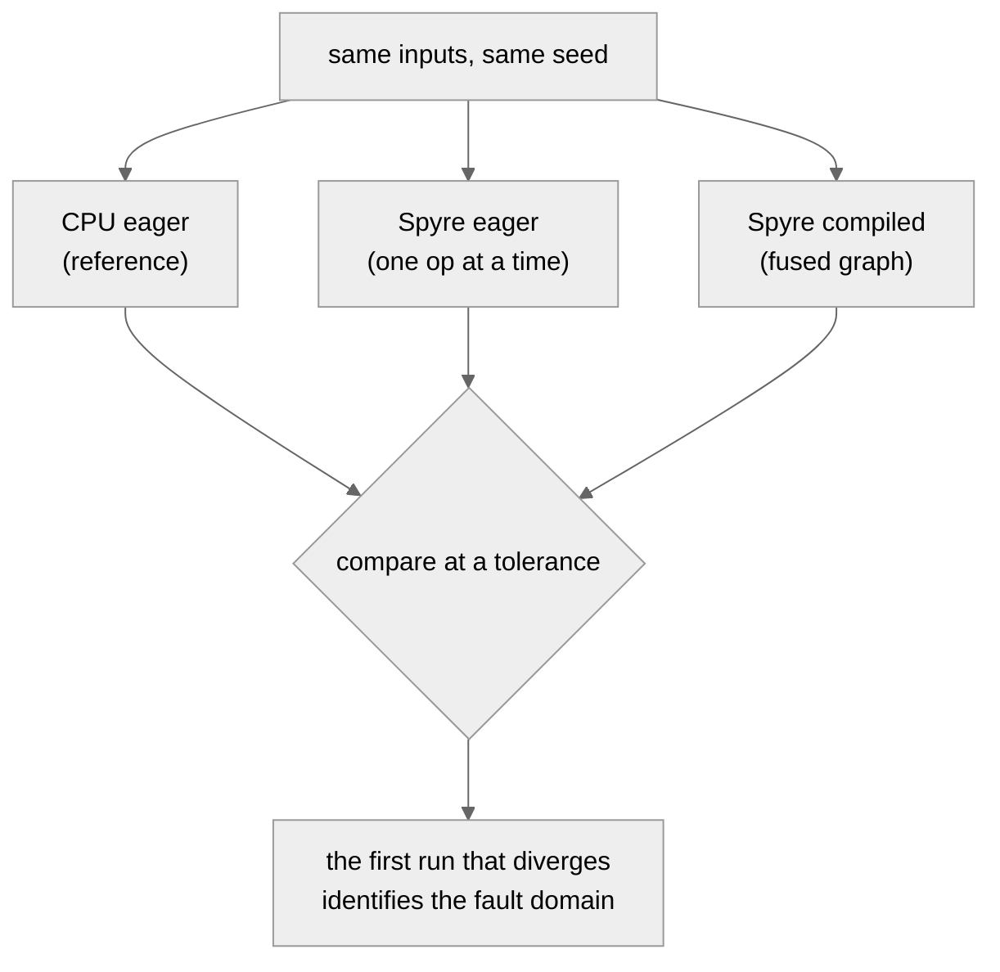

# Differential Testing Against CPU

On an eager framework you can stop at any line and print a tensor. On a
compiled dataflow target you cannot. The compiler fuses operations, keeps
intermediate values in on-chip memory that never reaches a buffer you can
read, and reports an error only at the next synchronization point. The
reliable way to find a wrong result is therefore comparison: run the same
computation on a trusted CPU reference and on the device, then find the
first point where they differ.

This method underpins every step in the [debugging workflow](index.md). It
is also the fastest way to answer the first question in any investigation:
does the wrong number come from your own code, or from the device backend?

## Comparing CPU and device



If the device **eager** run already diverges from CPU, a single operation is
wrong. If only the **compiled** run diverges, the fault is upstream in
lowering, fusion, or layout, not in the operation itself.

## The three runs

```python
import torch
import torch_spyre  # registers the "spyre" device

def model(x):
    return torch.softmax(x @ x.T, dim=-1)

x = torch.rand(64, 128, dtype=torch.float16)

ref      = model(x)                                   # CPU eager, the reference
eager    = model(x.to("spyre")).cpu()                 # Spyre, one op at a time
compiled = torch.compile(model)(x.to("spyre")).cpu()  # Spyre, fused graph

for name, out in [("eager", eager), ("compiled", compiled)]:
    ok = torch.allclose(out, ref, atol=0.1, rtol=0.1)
    print(name, "matches CPU" if ok else "DIVERGES")
```

The tolerance here is not arbitrary. It has to cover the fp16 accumulation
error of this computation, which is larger than the transfer floor of a bare
copy because a matmul plus softmax accumulates over 128 elements. The next two
sections show how to set it from the measured floor and the shape of the
mismatch rather than guess. The project test helper `compare_with_cpu` uses
`atol=rtol=0.1` as its fp16 default, which is a loose upper bound chosen to
pass real kernels; tighten it toward the floor when you can.

## Measure the transfer floor first

The device stores `float16` in its own format, so a value loses a small
amount of precision when it is copied to the device and back, with no
arithmetic performed. Measure that round-trip error before you judge any
kernel. It is the zero line for every comparison.

```python
x = torch.rand(128, 256, dtype=torch.float16)
floor = (x.to("spyre").cpu() - x).abs().max()
print("transfer floor:", floor.item())   # error with no compute
```

Use it as the baseline error for every comparison. A difference at the floor
is not a bug. The floor grows with the magnitude of the input, so measure it
for inputs in the range your model actually uses. For `float16` inputs in
`[0, 1)` the floor is about `0.00048828125`, which is the fp16 rounding step
in that range. The OpSpec Lab program `tests/op_specs/programs/01_add.py`
computes and prints this value; see [The OpSpec Lab](op_spec_lab.md).

## Reading the mismatch

Before you change a tolerance, look at the shape of the error. It tells you
which kind of bug you have.

| What you see | Likely cause | What to do |
|---|---|---|
| Almost every element wrong, absolute difference far above the floor | Structural: a wrong index, reshape, layout, or dispatch | Inspect the layout and copy range in the `sdsc` artifact. See [Common Failure Classes](failure_classes.md) |
| A few elements off by a small amount near the floor | `float16` accumulation order differs from CPU | Accept it, or raise the tolerance only after ruling out a structural cause |

Raising the tolerance to make a test pass is the most common debugging
mistake. A large, uniform mismatch does not become correct because the
tolerance is loosened. It is hidden.

## Exact value and poisoned lane probes

`allclose` is the wrong tool for a layout bug, because a single misplaced
element is masked by the tolerance you need for accumulation noise. Two
sharper probes find these directly.

An exact comparison catches a single misplaced element:

```python
assert torch.equal(got.cpu(), expected)   # bit-for-bit, no tolerance
```

A poisoned-lane probe catches a padding or layout bug in an op that mixes
values along the padded axis, such as a reduction or a softmax. Give the
device the unpadded tensor, for example 65 elements, so the device creates the
padding lanes itself (64 elements per stick, so the second stick has 63). Those
lanes should contribute nothing. The CPU reference runs on the clean 65
elements and never sees them, so comparing the two shows whether the device
read a padding lane:

```python
x = torch.rand(65, dtype=torch.float16)

ref = x.sum()                     # CPU reference over the real 65 elements
got = x.to("spyre").sum().cpu()   # device sums over its own padded stick

torch.testing.assert_close(got, ref, atol=0.1, rtol=0.1)
```

If the device includes a padding lane, `got` differs from `ref` by that lane's
contribution. The padding is normally zero, so a bug is easiest to see when the
device leaves stale data there. A finite sentinel makes a leak obvious, but it
has to be written on the device after the transfer, since the host tensor has
no padding to fill; `0x7FFF` is a poor sentinel either way, because that bit
pattern is a `NaN` that need not round-trip bit-for-bit. See
[Common Failure Classes](failure_classes.md) for the layout and padding
classes this detects.

## In the test suite

The project test suite implements this method in `compare_with_cpu`
(`tests/inductor/utils_inductor.py`). It runs a function eager on CPU, eager
on Spyre, and compiled on Spyre, and asserts closeness at a default tolerance
of `0.1`. New operator tests use it directly, so a test is a differential
test by construction.

## Next steps

- [Common Failure Classes](failure_classes.md) to recognize the bug once a
  run diverges.
- [Inductor Artifacts](inductor_artifacts.md) to read the layout and copy
  range that a structural mismatch points to.
- [The OpSpec Lab](op_spec_lab.md) to replay the failing kernel on its own
  and decide whether the backend or the front-end produced it.
